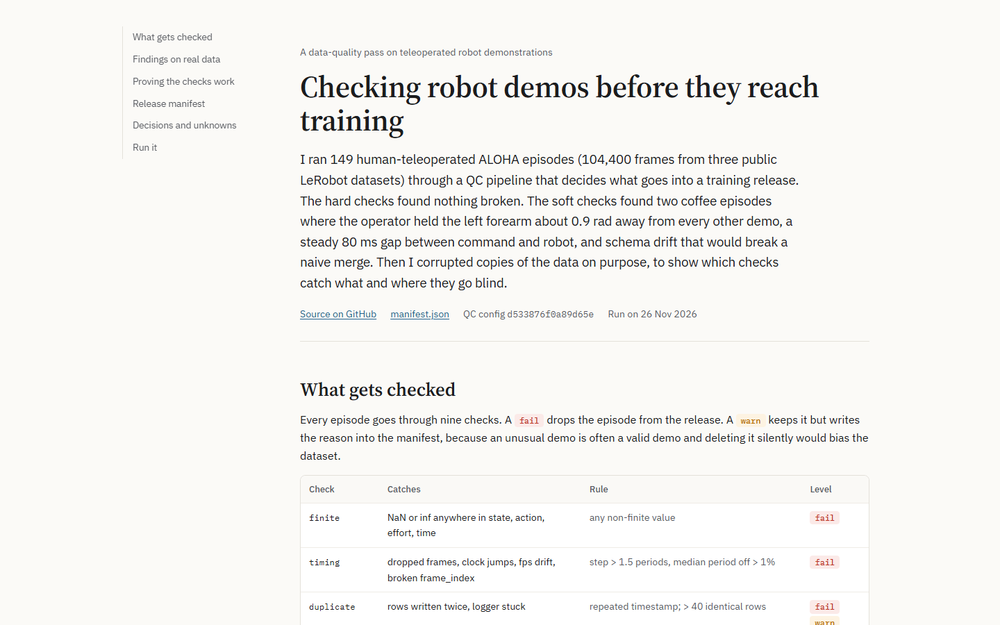

# robot-demo-qc

A quality-control pipeline for teleoperated robot demonstrations: it checks every episode before it reaches training, writes a pass / warn / fail verdict with reasons, and produces a versioned release manifest. Then it corrupts copies of the data on purpose to measure what each check actually catches.

**Live report:** https://robot-demo-qc.vercel.app



## Problem

Demonstration data for manipulation policies fails quietly. A dropped frame, a frozen joint sensor, a teleop glitch or a leader/follower sync shift does not crash training; it just teaches the policy something wrong. Checks have to run before every release, have to explain themselves, and have to be shown to work, because clean data alone proves nothing about a checker.

## What I built

- `qc/data.py` loads a LeRobot v3 dataset (parquet only) into per-episode numpy arrays.
- `qc/checks.py` has nine per-episode checks:

| Check | Catches | Level |
|---|---|---|
| `finite` | NaN / inf in state, action, effort, time | fail |
| `timing` | gaps > 1.5 frame periods, non-monotonic time, fps drift > 1%, broken `frame_index` | fail |
| `duplicate` | repeated timestamps (fail), > 40 bit-identical rows (warn) | fail / warn |
| `frozen` | joint reading exactly constant >= 25 frames while its action moved > 0.10 rad | fail |
| `saturation` | reading pinned at its extreme >= 10 frames while action asks 0.05 rad more | warn |
| `spike` | one-step jump > 4x reference p99.9 step and > 0.05 rad | fail |
| `lag` | action-to-state lag off the batch median by > 3 frames | fail |
| `length` | robust z > 4 on frame count | warn |
| `distribution` | robust z (MAD) > 6 on any per-episode feature: joint means/spreads, path length, tracking residual, effort | warn |

- Dataset-level checks: episode metadata vs parquet rows, index spans, video segment duration vs frames / fps for every camera, `stats.json` vs recomputed stats.
- `qc/inject.py` has 13 fault types plus an untouched control.
- `qc/run.py` runs everything and writes `reports/qc_report.json`, `release/manifest.json` and `site/data.js`.
- `site/index.html` is the static report page.

Thresholds live in `qc/config.py`. The config is hashed (`qc_config_hash`) together with the QC code (`qc_code_hash`) into the manifest, so a release id changes whenever a threshold does.

## Data

| Dataset | License | Gated | Revision | Episodes | Frames |
|---|---|---|---|---|---|
| [lerobot/aloha_static_coffee](https://huggingface.co/datasets/lerobot/aloha_static_coffee) | MIT | no | `b144896` | 50 | 55,000 |
| [lerobot/aloha_static_battery](https://huggingface.co/datasets/lerobot/aloha_static_battery) | Apache-2.0 | no | `06dc3da` | 49 | 29,400 |
| [lerobot/aloha_static_cups_open](https://huggingface.co/datasets/lerobot/aloha_static_cups_open) | MIT | no | `d793c96` | 50 | 20,000 |

Licence and gating were read from `https://huggingface.co/api/datasets/<id>` and are re-checked by `scripts/download.py` before downloading. All three are real ALOHA bimanual robots driven by human teleoperation at 50 fps. Only the parquet and metadata files were downloaded (5.6 MB). No video was downloaded.

## Results

**Real data (149 episodes, 104,400 frames):** 145 pass, 4 warn, 0 fail.

1. **Hard checks clean.** Every frame step is exactly 20.0 ms, frame indices are contiguous, no NaN/inf, metadata matches parquet rows, and video durations equal frames / fps to 0.0 ms on all 4 cameras.
2. **Two coffee demos use a different left-arm posture.** Episodes 0 and 22 average -0.27 and -0.37 rad of left forearm roll vs a median of +0.56 over the other 48 (robust z -7.9 and -8.9); episode 22's wrist rotate shifts the opposite way (z +6.7). Episodes 12 (left wrist angle spread, z +8.3) and 19 (right wrist rotate effort, z +7.5) are also flagged. All four are kept with flags.
3. **State trails action by 4 frames (80 ms).** True in all 50 coffee episodes; battery 44 at 4 frames / 5 at 5; cups 30 / 20.
4. **Effort is coarse.** Only coffee has `observation.effort`; it is quantized in steps of 2.69, and forearm-roll effort is exactly 0 in 57% (left) and 49% (right) of frames.
5. **Schema drift.** Battery has `robot_type: "unknown"` and joints named `motor_0..13`; only coffee has effort; each dataset uses a single fixed episode length (1100 / 600 / 400), so length cannot reveal cut-off demos here.

**Fault injection (1,937 corrupted episodes + 149 untouched controls), recall of the intended check, pooled:**

| Fault | Target check | Recall |
|---|---|---|
| 5 frames dropped | timing | 100% |
| 3 frames written twice | duplicate | 100% |
| clock jump +0.25 s | timing | 100% |
| recorder 3% slow | timing | 100% |
| joint frozen 1.5 s while moving | frozen | 100% |
| joint frozen 1.5 s, random spot | frozen | 40% (80% of freezes that changed the reading > 0.05 rad) |
| 0.30 rad one-frame spike | spike | 100% |
| 0.08 rad one-frame spike | spike | 47% |
| one NaN | finite | 100% |
| action shifted 10 frames | lag | 100% |
| joint clipped at 60% of range | saturation | 100% |
| one joint in degrees | distribution | 100% |
| left/right arms swapped | distribution | 100% |
| **untouched control** | any fail | **0%** |

## Decisions under incomplete information

- **Frozen threshold 0.10 rad.** First guess was 0.15. A sweep showed the worst untouched episode reaches 0.082 rad of commanded motion during a 0.5 s exact-constant reading, so 0.10 keeps zero clean alarms and raises recall on material random freezes from 62% to 80%. It was tuned on the same 149 episodes, so a new robot needs a new sweep.
- **Spike reference = median of per-episode p99.9 steps**, so corrupted episodes cannot raise their own threshold.
- **Outliers warn, never drop.** An unusual demo may be the most valuable one; a person or video check should decide.
- **Grippers are skipped in value comparisons** because leader and follower grippers report in different ranges.
- **Not verified:** task success (needs video or labels), why episodes 0 and 22 differ, the physical unit of effort, and whether 4 vs 5 frames of lag matters to the controller.

## How to run

```bash
pip install -r requirements.txt
python scripts/download.py   # ~5.6 MB, pinned revisions, checks licence + gating
python -m qc.run             # ~20-90 s on a laptop, includes fault injection
python -m pytest -q          # 15 tests on synthetic episodes, no download needed
```

The site is static: open `site/index.html`, or deploy the `site/` folder.

Made by Nitesh Kumar Yadav. Not affiliated with Intelligence Factory.
